# PipeWise 技术方案 v2.0（Java + React + Flowable 7）

> 对应 PRD v1.1（`index.html`）。本文定义 **Java 后端 + React 前端** 的实现契约：
> 总体架构、执行内核、数据模型、业务流程图、API、技术难点、组件选型与部署。
>
> **技术栈调整说明**：PRD 原文写的是 Python 服务端；团队已决策后端改为 Java 21 + Spring Boot，
> 前端改为 React。本文保持 PRD 的业务语义不变，只替换实现技术；脚本节点仍保留 Python 沙箱。
>
> 与 `docs/tech-design.md`（Python MVP）的关系：那份文档定义了 PipeWise 的业务语义与
> 49 个测试用例，本文把它平移到 Java/Flowable 技术栈；**语义以 PRD 为准，Python 实现作为
> 行为参考和回归用例来源**。

---

## 0. 结论摘要

### 0.1 技术选型

| 层 | 选择 | 理由 |
|---|---|---|
| 后端 | Java 21 + Spring Boot 3.5.x | 团队/公司主栈；生态、招聘、运维成熟 |
| 执行内核 | **Flowable 7.2（嵌入式，Apache 2.0）** | BPMN 2.0、版本化、并行网关、定时器、历史、迁移 API 都是现成的；不 fork |
| 人工任务/签核 | **自建业务任务层**（`pw_task` / `pw_sign_session`） | 中国式审批的会签、竞签、加签、退回、转办、委托，套 Flowable TaskService 会被多实例模型限制死 |
| 前端 | React 18/19 + TypeScript + Vite + shadcn/ui | 组件可控、可访问性好；设计器用 bpmn-js |
| 主存储 | PostgreSQL 14+（推荐 16） | 事务、JSONB、行锁、`SKIP LOCKED`、分区、GIN 索引 |
| 缓存 | Redis 7 | 定义/表单/组织缓存、限流、通知去重、短期幂等；**不存流程状态** |
| 对象存储 | MinIO | 附件、图片、导出文件；只存对象 key，不存业务状态 |
| 脚本运行时 | **独立 Python 3.12 沙箱服务** | PRD 要求 Python 脚本；复用现有 `sandbox_runner.py` 的白名单与 rlimit 方案 |
| 网关 | nginx | TLS、SSO 前置、静态资源、API 反代 |
| 身份 | 公司 SSO / OIDC（Keycloak 或现有 IdP） | 不在业务库里存密码 |

### 0.2 一句话架构

```
React（设计器 / 任务中心 / 表单 / 运维）
        │  REST /api/v1
        ▼
Spring Boot（API + 业务编排 + 自建签核任务层）
        │  嵌入式调用
        ▼
Flowable 7（BPMN 图执行、网关、定时器、历史、迁移）
        │
        ├── PostgreSQL（Flowable ACT_* + 业务 pw_*）
        ├── Redis（缓存 / 限流 / 去重）
        ├── MinIO（附件 / 导出）
        └── Python 脚本沙箱（独立进程/服务）
```

### 0.3 PG + Redis + MinIO 够不够？

**作为“存储三件套”，MVP 和中等规模够用**：

- PG 承担流程状态、业务数据、审计、Outbox，靠事务与行锁保证一致性；
- Redis 只做缓存和加速，挂掉不影响正确性；
- MinIO 承担所有大对象，PG 里只存 key。

但 PRD 的完整目标（1000 实例/秒、百万在跑实例、多租户、通知/超时/可观测）还需要：

| 缺口 | 是否首版必须 | 建议 |
|---|---|---|
| nginx / API 网关 | 必须 | 已有共享 nginx，足够 |
| SSO / OIDC | 生产必须 | 接公司 IdP，Keycloak 兜底 |
| Python 脚本沙箱运行时 | 必须（PRD FR-8） | 独立 sidecar/服务，不能跑在 Java 进程内 |
| 可观测性（Metrics/Trace/日志） | 生产必须 | Prometheus + Grafana + Loki/Tempo，或云监控 |
| 消息队列（Kafka/RocketMQ/Pulsar） | 首版不必 | PG Outbox 足够；服务节点/高吞吐事件扇出时再加 |
| 全文/复杂检索（ES/OpenSearch） | 首版不必 | PG JSONB + GIN + trigram 先顶；检索复杂后再加 |
| 独立 Worker 部署 | 中大规模需要 | Flowable 异步执行器可独立成 worker 集群 |
| 配置中心 / 密钥管理 | 可选 | K8s ConfigMap/Secret 或 Vault |
| 备份/容灾 | 生产必须 | PG PITR、Redis 持久化、MinIO 版本化 |

**结论**：三件套是正确的最小集合；不要把 Redis 当数据库，也不要把 MinIO 当流程存储。
首版真正需要补的不是更多存储，而是 **脚本沙箱服务、SSO、可观测性** 这三块。

### 0.4 与 PRD 的两处关键偏差（必须显式确认）

1. **脚本语言仍是 Python**：Java 后端不直接执行 Python。脚本节点由独立 Python 沙箱服务执行，
   Java 只负责传上下文、收结果、落审计。好处是保留 PRD 契约与现有沙箱实现；代价是多一个运行时。
2. **签核任务不完全交给 Flowable TaskService**：Flowable 负责“图怎么走”，我们自己的
   `pw_task/pw_sign_session` 负责“人怎么签”。原因见 §3.3：Flowable 的多实例任务在
   “运行中加签”“竞签回收”“退回后重提”这些语义上会越写越绕。

---

## 1. PRD → 技术实现对照

### 1.1 功能范围对照（FR）

| 编号 | PRD 能力 | 优先级 | 本方案实现方式 |
|---|---|---|---|
| FR-1 | 流程建模与设计器 | MVP | React + bpmn-js；自定义属性面板；发布前校验；JSON 导入导出；试跑 |
| FR-2 | 发布与版本管理 | MVP | Flowable Deployment 版本 + `pw_definition_version` 元数据；实例钉 `processDefinitionId`；灰度/下线在业务层 |
| FR-3 | 实例生命周期 | MVP | Flowable Runtime/History + `pw_instance` 状态缓存；suspend/resume/terminate |
| FR-4 | 审批与任务 | MVP | **自建 `pw_task`**：待办/已办、同意/否决/退回/加签/转交/撤回/催办 |
| FR-5 | 签核体系 | MVP | `pw_sign_session` 裁决引擎；BPMN 侧只保留一个协调任务 |
| FR-6 | 网关与分支 | MVP | Flowable exclusive/parallel gateway；inclusive 网关 P1 |
| FR-7 | 流程上下文 | MVP | Flowable 变量为运行值 + `pw_variable_log` 审计；敏感字段应用层加密/脱敏 |
| FR-8 | 节点脚本 | MVP | 独立 Python 沙箱服务；白名单 + rlimit + 超时；重试/onError/挂起 |
| FR-9 | 服务节点与集成 | P1 | Flowable serviceTask + HTTP/MQ connector；Outbox/幂等 |
| FR-18 | 表单引擎 | MVP | 自建表单 Schema/版本/绑定/权限矩阵/数据表；React 表单设计器 + Schema 渲染器 |
| FR-19 | 表单高级能力 | P1 | 子表单、联动、计算、数据源、模板库、草稿 |
| FR-20 | 表单数据与检索 | P1 | `pw_form_data.indexed_json` + GIN；复杂检索再上 ES |
| FR-21 | 多端渲染 | MVP | PC 响应式 Web；飞书 H5 复用同一 Schema 渲染器 |
| FR-10 | 子流程 | P1 | Flowable callActivity / embedded subprocess |
| FR-11 | 定时与延时 | P1 | Flowable timer + async executor；超时策略表 |
| FR-12 | 通知 | P1 | 事件驱动；Feishu/邮件/站内信适配器；去重表 |
| FR-13 | 权限与组织 | MVP | SSO + RBAC/数据范围；`OrgProvider` 组织解析器 + Redis 缓存 |
| FR-14 | 监控与运维 | P1 | 实例大盘、卡点、干预、重跑；Prometheus/Grafana |
| FR-15 | 开放 API / SDK | MVP | REST + OpenAPI；Idempotency-Key；Webhook Outbox；Python/Java SDK |
| FR-16 | 长跑实例迁移 | P2 | Flowable `ProcessMigrationService` + 活动映射 + 预演/回滚/灰度 |
| FR-17 | 多租户 | P2 | Flowable tenantId + 业务表 `tenant_id`；行级隔离 + 配额 |

### 1.2 四条验收主线

| 场景 | 技术验证点 |
|---|---|
| S1 请假 | 或签 → 排他网关 → 并行 fork/join → 脚本/服务节点 → 结束 |
| S2 合同 | 金额分支；三方并签 + 一票否决；小额竞签 + 其余任务回收 |
| S3 长跑 + 版本升级 | 实例钉旧版本；新版本只影响新实例；P2 显式迁移 |
| S4 同一表单多节点权限 | 隐藏/只读/可编辑/必填随节点变化；越权字段服务端丢弃 |

### 1.3 PRD 章节覆盖索引

| PRD 章节 | 本文位置 |
|---|---|
| 01 背景/目标/非目标/原则 | §0、§1 |
| 02 名词与概念模型 | §3.1 |
| 03 角色与核心场景 | §1.2、§2.5 |
| 04 功能范围与优先级 | §1.1 |
| 05 建模与设计器 | §4.1、§9.3 |
| 06 发布与版本管理 | §4 |
| 07 实例生命周期 | §2.5、§3、§10 |
| 08 审批与签核 | §3.3–3.5 |
| 09 网关/并行/汇聚 | §3.1、§3.6、§13.2 |
| 10 表单引擎 | §5 |
| 11 上下文系统 | §6 |
| 12 脚本与服务节点 | §6.5、§7 |
| 13 通知/超时/运维 | §7 |
| 14 开放 API/SDK | §8 |
| 15 非功能 | §12 |
| 16 数据模型 | §10 |
| 17 边界与异常 | §14.3 |
| 18 权限矩阵 | §12.3.1 |
| 19 成功指标 | §12.1 |
| 20 里程碑 | §15.1 |
| 21 风险/开放问题 | §15.2、§15.3 |
| 附录 A 技术选型 | §3.2、§15.3 |

---

## 2. 总体架构

### 2.1 分层

```
┌──────────────────────────────────────────────────────────────────┐
│ 接入层   nginx / SSO / REST /api/v1 / Webhook / 静态 React 资源     │
├──────────────────────────────────────────────────────────────────┤
│ 应用层   Spring Boot                                             │
│  ├─ definition  定义/草稿/版本/发布/校验/试跑                      │
│  ├─ instance    实例生命周期/查询/时间线/干预                      │
│  ├─ task        自建任务层：待办/签核/加签/转交/退回/催办           │
│  ├─ form        表单 Schema/版本/权限矩阵/数据/附件                 │
│  ├─ context     变量读写/审计/敏感字段/表达式                       │
│  ├─ event       Outbox/Webhook/通知                                │
│  └─ org         组织/角色/审批人解析（OrgProvider）                 │
├──────────────────────────────────────────────────────────────────┤
│ 执行层   Flowable 7（BPMN 图执行/网关/定时器/历史/迁移）            │
│          Python Script Runner（独立服务，脚本沙箱）                 │
├──────────────────────────────────────────────────────────────────┤
│ 存储层   PostgreSQL（主）· Redis（缓存）· MinIO（对象）             │
└──────────────────────────────────────────────────────────────────┘
```

### 2.2 模块划分（后端）

```
com.pipewise
├── api/                 REST Controller + DTO + 错误处理
├── definition/          草稿、版本、发布、校验、BPMN<->JSON
├── instance/            实例查询、生命周期、时间线
├── task/                自建任务层、签核裁决、加签/转交/退回
├── form/                Schema、版本、绑定、权限矩阵、数据、附件
├── context/             变量服务、审计、敏感字段、表达式校验
├── script/              Python 沙箱客户端、输出映射、重试
├── org/                 OrgProvider、审批人解析器、缓存
├── event/               Outbox、Webhook、通知适配器
├── admin/               运维干预、大盘、迁移
└── common/              事务、幂等、租户、鉴权、观测
```

### 2.3 两个部署形态

**MVP / 单机**

```
nginx
 ├─ /                 React dist（静态）
 └─ /api/             Spring Boot :8082
Spring Boot
 ├─ Flowable 7（嵌入式）
 ├─ 业务模块
 └─ 异步执行器（Flowable job executor）
PG / Redis / MinIO
Python script-runner（127.0.0.1:8090，或同容器 sidecar）
```

**生产 / 水平扩展**

```
                 ┌──────────── nginx / LB ────────────┐
                 │                                    │
         ┌───────▼────────┐                  ┌────────▼───────┐
         │ app-1 (API)    │                  │ app-2 (API)    │
         │ Spring Boot    │                  │ Spring Boot    │
         └───────┬────────┘                  └────────┬───────┘
                 │                                    │
         ┌───────▼────────┐                  ┌────────▼───────┐
         │ worker-1       │                  │ worker-2       │
         │ Flowable async │                  │ 定时/Outbox/脚本│
         └───────┬────────┘                  └────────┬───────┘
                 └──────────────┬─────────────────────┘
                                ▼
        PostgreSQL（主从）· Redis（Sentinel/Cluster）· MinIO（多节点）
                     Python script-runner（独立部署，网络隔离）
```

**关键原则**：API 与 Worker 无状态；Flowable 的异步执行器与 Outbox 投递可以在所有副本上跑，
靠数据库锁/`SKIP LOCKED`/Flowable 集群锁避免重复；脚本沙箱单独部署、只允许内网调用。

### 2.4 请求事务边界

所有写操作使用 Spring `@Transactional`，Flowable 的 Service 调用加入同一个事务：

```
Controller → Service（@Transactional）
  ├─ 业务表写入（pw_task / pw_form_data / pw_audit_log ...）
  ├─ Flowable 操作（taskService.complete / runtimeService.trigger）
  ├─ Outbox 写入（同事务）
  └─ 提交
       ↓
   @TransactionalEventListener(AFTER_COMMIT) → 异步投递/通知
```

**禁止**：在事务内直接 `HTTP POST` 回调、发 MQ、调用脚本沙箱之外的外部服务。
脚本沙箱调用是一个例外，但要明确它的超时与失败语义：脚本失败 → 按策略重试/onError/FAILED，
不得让沙箱的 HTTP 超时把数据库事务拖到超时。

---

### 2.5 核心业务流程图

#### S1 请假审批

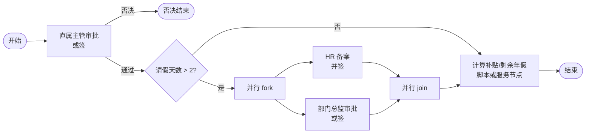

#### S2 采购合同

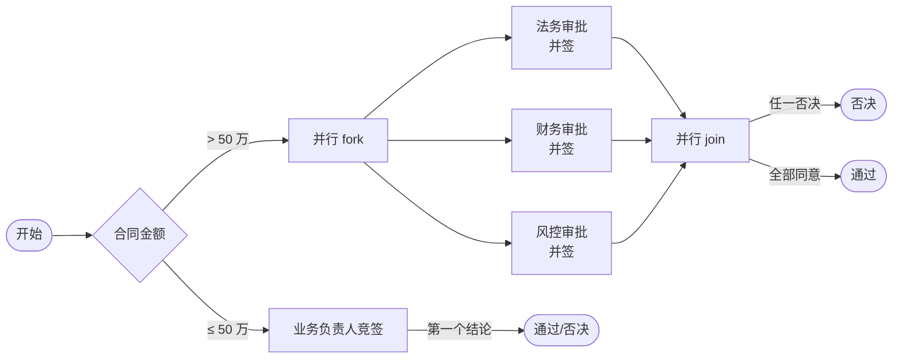

#### S4 同一表单、不同节点权限

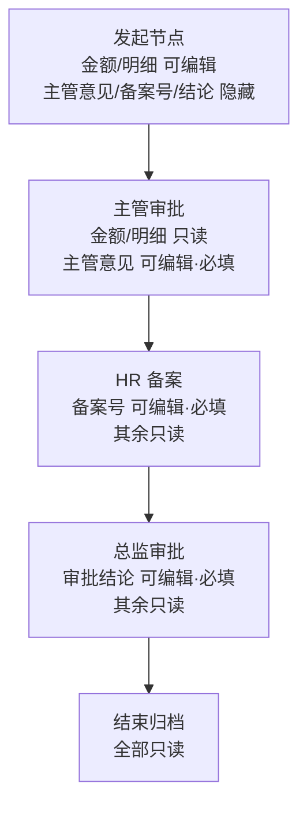

#### 实例生命周期

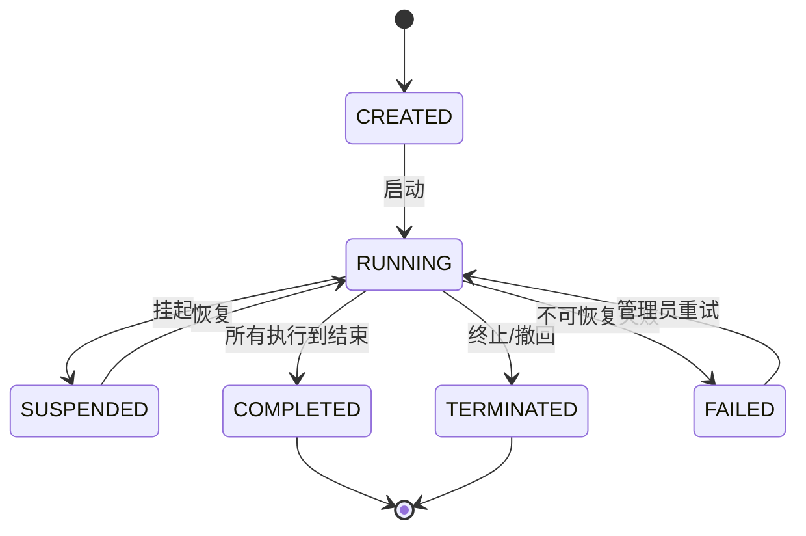

#### 任务生命周期

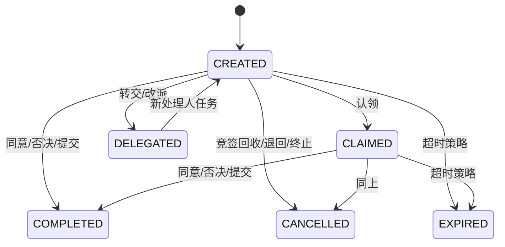

#### 创建实例（事务边界）

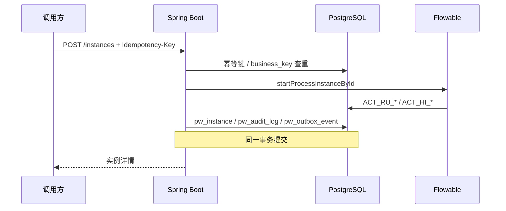

#### 完成任务（签核裁决 + 引擎推进）

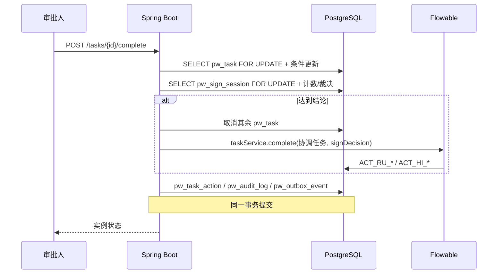

#### 发布版本

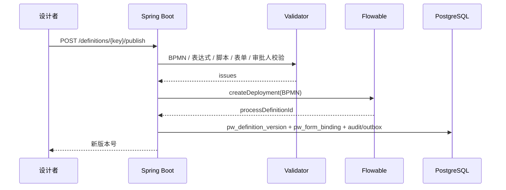

#### Outbox 投递

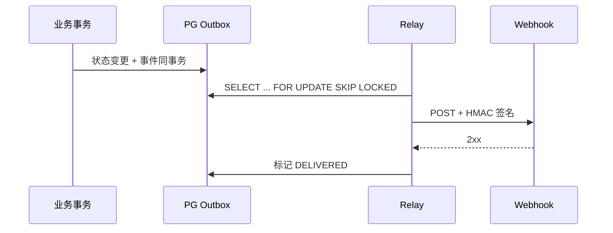

---

## 3. 执行内核：Flowable 7 + 自建任务层

### 3.1 Flowable 概念与 PRD 概念的映射

| PRD 概念 | Flowable 对应 | 说明 |
|---|---|---|
| 流程定义 definition | `ProcessDefinition` key | Flowable 的 key 就是稳定标识 |
| 流程版本 version | `ProcessDefinition.version` | 每次 deployment 自增；实例钉 `processDefinitionId` |
| 节点 node | `Activity` / `FlowNode` | BPMN XML 中的元素 |
| 边 edge | `SequenceFlow` + condition | 条件用 JUEL |
| 实例 instance | `ProcessInstance` / `HistoricProcessInstance` | businessKey 存在 Flowable 实例上 |
| 令牌 token | `Execution` 树 | Flowable 用 execution 父子关系表达并行；**不要另建 token 表** |
| 节点实例 node_instance | `HistoricActivityInstance` | 每次激活一条历史活动 |
| 任务 task | **自建 `pw_task`** | Flowable 的 userTask 只作为“等待协调器”，见 §3.3 |
| 上下文 context | Flowable variables + `pw_variable_log` | 运行值在 Flowable，审计在业务表 |
| 快照 snapshot | BPMN XML + `pw_definition_version.model_json` | BPMN 是执行真相；JSON 是设计/API 视图 |

> **不要重复实现 Flowable 的 execution/token 表**。PRD 的令牌语义在 Flowable 里就是 execution
> 树；自建 token 表会导致两套状态互相打架。

#### 3.1.1 节点类型映射

| PRD 节点 | Flowable 元素 | 本期 | 说明 |
|---|---|---|---|
| start | `startEvent` | MVP | 唯一入口 |
| end | `endEvent` | MVP | 结束/否决结束 |
| approval | `serviceTask`(openSign) + `userTask`(waitSign) | MVP | 真实任务在 `pw_task`，见 §3.3 |
| form | `serviceTask`(openFormTask) + `userTask`(waitForm) | MVP | 填写型任务，无同意/否决 |
| script | `serviceTask` + Python runner | MVP | 输出去向由 `route` 变量/边条件决定 |
| service | `serviceTask`（HTTP/MQ connector） | P1 | 超时/重试/幂等键 |
| cc | `serviceTask`（只发通知，不阻塞） | P1 | 零等待 |
| exclusive_gateway | `exclusiveGateway` | MVP | 必须有默认边 |
| parallel_gateway | `parallelGateway` | MVP | fork/join；嵌套 ≤3 |
| inclusive_gateway | `inclusiveGateway` | P1 | 汇聚只等实际激活分支 |
| timer | `intermediateCatchEvent` timer / boundary timer | P1 | 持久化在 Flowable job 表 |
| wait | `receiveTask` / message catch | P1 | 外部回调唤醒 |
| sub_process | embedded subprocess / `callActivity` | P1 | 输入/输出映射 |
| plugin | `serviceTask` + 注册式 delegate | P2 | 平台方扩展 |

发布校验对 P1/P2 节点显式拒绝或标记“未启用”，避免“配了但不生效”。

### 3.2 为什么选 Flowable，而不是自研/别的引擎

- Flowable 7 是 Apache 2.0，可嵌入 Spring Boot，BPMN/DMN/CMMN 齐全；
- 进程内嵌（`flowable-spring-boot-starter-process`），不需要独立集群；
- 版本化、并行网关、定时器、历史、迁移 API 都是现成的；
- 相比 Camunda 8：不需要为生产自托管付授权费，也不需要额外运维 Zeebe 集群；
- 相比 Warm-Flow/FlowLong：BPMN 标准、企业能力、生态更强；但中国式审批语义要自己补。

**和 PRD 附录 A（DBOS/Restate/Temporal）的关系**：附录 A 的出发点是“durable execution 内核
不自研”，这在“服务编排/Agent 长任务”场景成立。本产品的主体是**人工审批 + 长跑实例**：
版本化、人工任务、定时器、历史、迁移、BPMN 网关是核心，正是传统 BPMN 引擎的强项；Flowable
用数据库事务 + 持久化 execution 同样提供崩溃恢复。若未来做服务节点/Agent 编排，可以另接
Temporal 作为执行层，不必替换流程引擎。**本期选择 Flowable，不是否定附录 A，而是按产品形态
选更贴合的内核。**

另外，PRD 明确“不做完整 BPMN 2.0 兼容”。Flowable 支持完整 BPMN，但我们只暴露 §3.1.1 的
子集；冷门事件子流程/补偿边界事件不进入产品能力。

### 3.3 关键设计：Flowable 管“图”，我们管“人”

#### 问题

Flowable 原生的 `userTask` + `multiInstance` 能表达或签/会签/竞签，但 PRD 还要求：

- 运行中**加签**（会签集合动态增加）；
- **竞签**第一个结论定音，其余任务立即回收；
- **退回**到发起人/上一节点/指定节点，重提有“保留已通过/全部重走”两种语义；
- 转交、委托、改派、催办、超时；
- 任务列表要有业务字段、表单权限、意见附件、审计。

把这些都压在 Flowable 多实例任务上，会遇到：

- 多实例的 `nrOfInstances` 在创建时固定，运行中加签没有官方“加一个实例”的 API；
- 竞签回收、退回重提需要大量自定义完成条件与监听器，BPMN 会变成“能跑但没人敢改”；
- Flowable TaskService 的字段不够（业务表单、权限、附件、意见），最后还是要建业务表。

#### 方案

**每个“人工节点”在 BPMN 里只有两个元素**：

```xml
<!-- 打开签核会话：解析审批人，创建 pw_task 行 -->
<serviceTask id="openSign" flowable:delegateExpression="${signService.openSession}"/>

<!-- 等待协调器：一个系统账号的 userTask，业务用户看不到 -->
<userTask id="waitSign" name="等待签核" flowable:assignee="${signCoordinator}"/>

<sequenceFlow id="..." sourceRef="openSign" targetRef="waitSign"/>
```

- `openSign` 在引擎事务内解析审批人，写入 `pw_sign_session` + N 条 `pw_task`；
- 真正的待办、签核、加签、转交都在 `pw_task` 上做；
- 签核会话达到结论时，`SignService` 在同一事务里：
  1. 更新 `pw_task` / `pw_sign_session`；
  2. 调用 `taskService.complete(coordinatorTaskId, vars)`，把 `signDecision` 写回流程；
  3. 后续 BPMN 网关按 `signDecision` 路由。
- `waitSign` 任务不出现在用户任务列表；查询用户待办只查 `pw_task`。

#### 收益

| 能力 | 实现 |
|---|---|
| 或签 | 第一个 approve → 决策 approve，取消其余 `pw_task` |
| 并签 | 统计 approve/reject，达到 `approveRatio` 或全员完成；`vetoOnReject` 立即否决 |
| 竞签 | 第一个完成 → 决策即结论，其余任务 CANCELLED |
| 加签 | 直接往会话插入 `pw_task`，`expected_count++`；不需要改 BPMN |
| 转交/委托/改派 | 改 `pw_task.assignee`，写审计 |
| 退回/重提 | 取消会话任务；BPMN 走 return 边/回到 start；重提建新任务 |
| 任务列表 | 自己的表，索引、分页、业务字段、权限都好做 |
| 审计 | `pw_task_action` + `pw_audit_log` 完整记录 |

#### 代价

- 要自己实现任务状态机、并发控制、查询与统计；
- 不能直接用 Flowable Tasklist UI（我们本来就要 React 自研）；
- Flowable 的 `ACT_HI_TASKINST` 里只有协调任务，用户任务历史要从 `pw_task` 查；
- 需要保证“业务表 + Flowable 完成协调任务”在同一事务里。

> 这个取舍是全案最重要的架构决策。**如果首版只追求最快跑通，可以先用 Flowable 多实例任务，
> 把加签/退回降级到 P1；但要做 PRD 的完整签核语义，推荐从一开始就用自建任务层。**

### 3.4 签核状态机

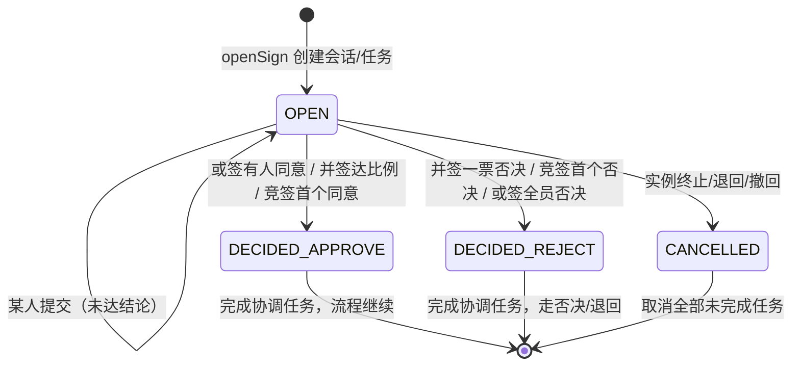

裁决规则（与 PRD §8.1 完全一致）：

| 模式 | 收到 approve | 收到 reject | 结束条件 |
|---|---|---|---|
| ANY | 立即通过，取消其余任务 | 只记录，不结束 | 有人同意；或全员拒绝 |
| ALL | 记录；达到比例且无否决 → 通过 | `vetoOnReject` 立即否决；否则记录 | 全员完成或达比例/否决 |
| RACE | 第一个完成 → 通过 | 第一个完成 → 否决 | 第一个完成的 verdict |

并发控制：

```sql
-- 提交任务：状态条件更新，0 行 = 已被别人处理
UPDATE pw_task
SET status = 'COMPLETED', verdict = ?, completed_at = now(), version = version + 1
WHERE id = ? AND status IN ('CREATED','CLAIMED');

-- 会话计数：行锁串行化
SELECT * FROM pw_sign_session WHERE id = ? FOR UPDATE;
```

`SignService.completeTask()` 的顺序：

1. 锁 `pw_task`（`FOR UPDATE`）→ 条件更新为 COMPLETED；
2. 锁 `pw_sign_session` → 累加计数/更新状态；
3. 若达到结论 → 取消其余任务（`CANCELLED`，写审计）→ 完成 Flowable 协调任务；
4. 写 `pw_task_action`、`pw_audit_log`、Outbox 事件；
5. 提交事务。

> 并发提交同一任务：第二个请求的条件更新 rowcount=0 → 返回 409 `TASK_ALREADY_DONE`。
> 并发提交不同任务：会话行锁保证计数不丢。

### 3.5 退回、撤回、终止、重提

| 动作 | 实现 |
|---|---|
| 退回发起人 `to_start` | 取消会话任务；BPMN 走 `return` 边到 start 的等待点；给发起人建 `RESUBMIT` 任务 |
| 退回上一节点 `to_prev` | 记录路径；取消当前会话；`ProcessInstanceModification`/change state 回到上一人工节点 |
| 退回指定节点 `to_node` | 白名单节点；change state 到目标活动；二次确认 + 审计 |
| 否决终止 `terminate` | 会话决策 reject；BPMN 到 reject end；实例 outcome=rejected |
| 撤回 | 首个人工任务被处理前允许；取消全部任务；终止实例或回到草稿 |
| 重提 restart | 当前 MVP：取消在途任务，回到 start 重新走（全部重走） |
| 重提 resume | P1：保留已通过节点；依赖活动映射/路径痕迹，与迁移工具同批 |

Flowable 的 `ChangeActivityStateBuilder` 可以做活动跳转，但要处理并行分支、子流程、活动映射；
**退回/迁移必须包裹在“预演 → 执行 → 审计 → 可回滚”的流程里**，不要直接暴露给普通用户。

### 3.6 循环与步数保护

Flowable 没有 PRD 要求的“实例最大步数/单节点最大激活次数”开箱配置，需要自建：

- 在 `openSign` / 每个节点的 `ExecutionListener` 上累加 `pw_instance.step_count`；
- 每进入一个节点，统计该 `(process_instance_id, activity_id)` 的历史活动次数；
- 超过阈值（默认 1000 / 100）→ 抛业务异常 → 将实例标记 FAILED/挂起 + 告警，不继续推进；
- 阈值从配置中心读取，可按租户覆盖。

### 3.7 表达式与条件

- Flowable 网关条件用 JUEL（`${...}`）。
- **发布期校验**：解析 JUEL 表达式，只允许变量、字面量、比较/布尔/算术、白名单函数；
  禁止方法调用、Bean 引用、`T(...)`、构造函数、静态方法。
- **运行期**：自定义 `ExpressionManager`（或限制 `VariableScopeElResolver`）阻断任意 Bean 访问；
  复杂逻辑不要写进表达式，改为一个脚本/服务节点先算出 `route` 变量，网关只判断
  `${route == 'approve'}`。
- 金额用 `BigDecimal`/decimal 字符串，禁止 `double` 参与金额比较。

> 安全原则：**表达式只做只读判断，不做业务计算；用户可写的表达式永远不能触达 Spring Bean。**

---

## 4. 版本、发布与迁移

### 4.1 版本模型

```
pw_definition（稳定标识 key）
  └── pw_definition_version（v1, v2, ...；不可变）
        ├── flowable_process_definition_id → ACT_RE_PROCDEF
        ├── model_json（设计态 JSON：节点/边/变量/发起角色）
        ├── bpmn_xml（可选，便于导出/diff；Flowable 自己也存）
        ├── variables_schema / startable_roles / gray_rule
        └── pw_form_binding（每个节点 × 表单版本 × 字段权限）
```

- **执行真相是 BPMN XML + Flowable deployment**；`model_json` 是 API/设计器的视图，发布时从
  BPMN 生成/校验，保证二者一致。
- 每次发布都会：
  1. 校验 BPMN（结构/表达式/脚本/表单引用/审批人解析器模拟）；
  2. 转换扩展属性（formRef、fieldPermissions、signMode、rejectStrategy、timeoutPolicy）；
  3. 调用 `repositoryService.createDeployment().addString(...)` 部署；
  4. 写 `pw_definition_version`，更新 `pw_definition.current_version`；
  5. 物化 `pw_form_binding`；
  6. 写审计 + Outbox（`definition.published`）。

### 4.2 定义/版本发布状态机

> 草稿存在 `pw_definition.draft_json`（带 `draft_rev` 乐观锁），**不是一行版本记录**。
> 设计者提交时才冻结出 `pw_definition_version(status=SUBMITTED)`；管理员发布时才部署到
> Flowable 并置为 `PUBLISHED`。这样“草稿可随意改”和“版本不可变”不会互相污染。

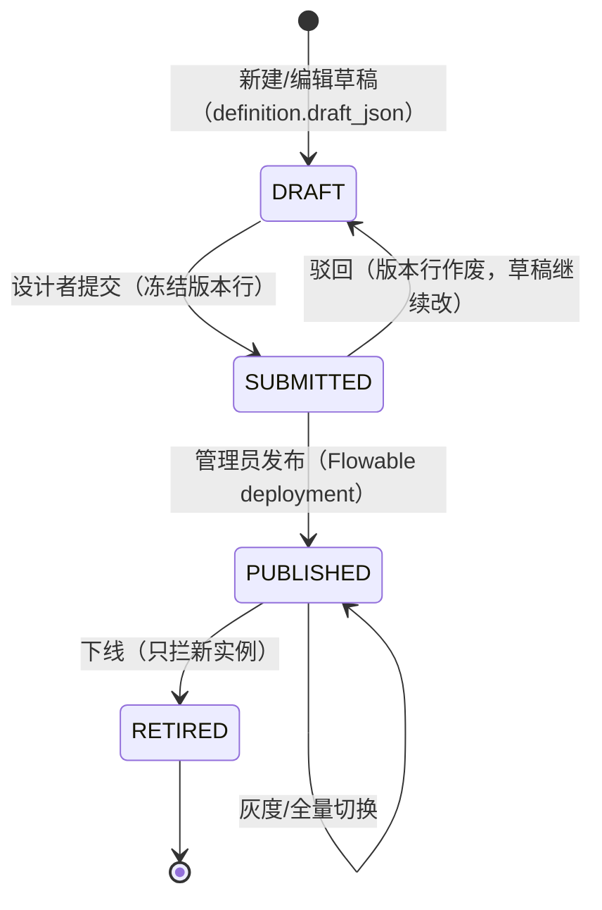

- **实例钉版本**：Flowable `ProcessInstance.processDefinitionId` 创建时确定，终身不变；
- **默认版本**：`pw_definition.current_version`，业务按 key 启动时取它；
- **下线**：只阻止新实例；运行中实例继续跑；
- **灰度**：按租户/发起人/比例选择版本；启动时由 `VersionRouter` 决定用哪个
  `processDefinitionId`；
- **版本对比**：对 `model_json` 做图级 diff（节点/边/变量/脚本/表单绑定），不是文本 diff。

### 4.3 发布流水线

```
设计器保存草稿
  → 结构校验（唯一 start/end、边引用、fork/join 配对、嵌套深度）
  → 表达式白名单校验
  → 脚本语法/白名单校验（调用 script-runner 的 check 接口）
  → 表单引用/字段权限校验
  → 审批人解析器模拟（至少能解析出一个候选人，或显式 emptyPolicy）
  → 试跑（Dry Run：创建临时实例，自动完成任务，最后回滚）
  → 设计者提交
  → 管理员发布（可配免审批通道）
  → Flowable Deployment + 版本元数据 + 表单绑定
```

**试跑**：在独立事务里创建实例、自动完成人工节点、执行脚本，最后 `rollback`；
实例标记 `dry_run=true`，不出现在业务列表。Flowable 的 deployment 不要为试跑创建新版本，
可以用当前已发布版本 + 临时变量跑。

### 4.4 长跑实例迁移（P2）

Flowable 提供 `ProcessMigrationService` 与 `ProcessInstanceMigrationBuilder`：

```
1. 预演：给定 fromVersion → toVersion，扫描运行中实例，输出冲突报告
   - 当前活动在目标版本不存在
   - 活动类型变化（userTask → serviceTask）
   - 变量契约变化
2. 活动映射：为每个冲突活动指定目标活动（等价/跳过/回退）
3. 备份：迁移前对实例做快照（变量/活动/任务），存 `pw_migration_snapshot`
4. 灰度：白名单实例先迁 1 个，验证后批量
5. 执行：Flowable migration API，事务内完成
6. 审计：`pw_migration_job` + 时间线 `migrated_from`
7. 回滚：失败时按快照恢复/重新迁移回旧版本
```

默认策略仍是**不迁移**：旧实例跑完旧版本。迁移是显式、可预演、可回滚的管理员操作。

---

## 5. 表单引擎

### 5.1 定位

表单是“流程上下文的人机接口”，不是通用低代码平台。只服务流程节点：
同一张表单可被多个流程/节点复用，字段名就是上下文变量名。

### 5.2 Schema 与字段类型

```json
{
  "key": "expense_form",
  "name": "费用报销单",
  "fields": [
    { "name": "amount", "label": "报销金额", "type": "amount", "required": true },
    { "name": "items", "label": "费用明细", "type": "textarea" },
    { "name": "supervisor_comment", "label": "主管意见", "type": "textarea" },
    { "name": "hr_no", "label": "HR 备案号", "type": "text" },
    { "name": "decision", "label": "审批结论", "type": "select",
      "options": [{"label":"同意","value":"approve"},{"label":"否决","value":"reject"}] }
  ]
}
```

MVP 字段类型：`text / textarea / number / amount / date / datetime / switch / select /
multi_select / rating / user / dept / file / static`；P1：子表单、联动、计算、数据源、模板、草稿。

### 5.3 节点 × 字段权限矩阵

存储：

```sql
pw_form_binding(
  id, definition_version_id, node_id, form_version_id,
  field_permissions_json,          -- {"amount":{"access":"readonly"}, ...}
  UNIQUE(definition_version_id, node_id)
)
```

规则：

- 未配置 → `readonly`（默认只读）；
- `hidden` 字段**不下发**给前端；
- `required` 只在 `editable` 时生效；
- 同一张表单在不同节点返回不同 `access/required/value`；
- 前端只渲染服务端给的权限，**不做权限判断**。

### 5.4 三层校验

| 层 | 实现 |
|---|---|
| 前端即时 | Schema 生成 required/pattern/min/max，失焦提示 |
| 服务端提交 | 类型/长度/正则/范围/选项/跨字段表达式；越权字段丢弃 + 审计 |
| 流转前 | 与提交同一入口；表单校验、写变量、完成任务、Flowable 推进同事务 |

**越权字段策略**：`hidden/readonly` 字段被提交且值与原值不同 → 丢弃并写
`form.unauthorized_fields_dropped` 审计，不报错。前端可篡改，服务端必须以权限矩阵为准。

### 5.5 表单与上下文

- 字段名 = 变量名；提交即写 Flowable 变量 + `pw_form_data`；
- 脚本改变量后，下次 `GET form` 返回新值；
- `pw_form_data.indexed_json`：标记 `queryable` 的字段抽出来，建 GIN/表达式索引；
- 敏感字段：应用层加密后写入 Flowable 变量，展示脱敏，审计脱敏；
- 附件：上传到 MinIO，`pw_attachment` 存 object key；表单数据只存附件 ID/key。

### 5.6 草稿与多端

- 草稿 P1：`pw_form_draft(tenant, definition_key, user_id, business_key, data_json)`，不启动实例；
- PC + 移动端共用同一 Schema；React 渲染器按 `layout` 适配；飞书 H5 用同一渲染器，
  容器鉴权/JSSDK 接入放 P1；
- 打印/导出 P1：PDF/Excel 从 `pw_form_data` + 流程记录生成；
- **表单设计器（MVP）**：左侧字段面板、中间画布、右侧属性面板、实时预览、PC/移动预览切换；
  支持 Schema 导入导出；表单模板库（报销/请假/采购）放 P1；
- 表单与流程版本绑定关系可视化（哪些节点用了哪张表单、权限矩阵）放运维/设计器详情页。

---

## 6. 上下文与脚本

### 6.1 变量作用域与存储

| 作用域 | 存储 | 说明 |
|---|---|---|
| 流程级 | Flowable process variables + `pw_variable_log` | 全实例可见 |
| 节点局部 | Flowable local variables（execution scope） | 节点结束归档，不删除 |
| 子流程 | Flowable 子流程变量 | 输入/输出映射 |
| 只读 env | Redis 缓存 + 组织/字典服务 | 组织架构、字典 |

- **运行值以 Flowable 变量为准**；不要建第二张 `pw_variable` 当前值表，避免双写。
- `pw_variable_log` 记录每次写入：旧值/新值/actor/节点/任务/是否脱敏。
- 未声明变量：默认宽松允许但写审计；严格模式可配置。

### 6.2 并发写保护

- Flowable 的 execution 有乐观锁；同一 execution 的并发变量写可能抛
  `FlowableOptimisticLockingException`。
- 业务层对“同一实例的变量写”做串行化：
  - 以 `instance_id` 为 key 的 PG advisory lock（事务级）或 Redis 锁（仅加速，不保证正确性）；
  - 捕获乐观锁异常 → 按配置 `retry`（脚本）/`fail`（挂起）/`last_write_wins`（管理员）。
- 表单提交和脚本写入都在 `@Transactional` 内，冲突时整个事务回滚，不会出现半写。
- 设计器对“多个并行分支写同一流程变量”给出结构性警告。

### 6.3 敏感变量

- Schema 可标记 `sensitive: true`；
- 写入前应用层加密（AES-GCM，密钥来自 KMS/环境变量）；
- Flowable 变量里存密文或引用；`pw_variable_log`/审计/日志全部脱敏 `***`；
- 展示时按权限解密；导出需二次授权。

### 6.4 表达式

- 只读、无副作用；变量引用、比较、布尔、算术、`in`、白名单函数；
- 发布期 AST/语法白名单校验；禁止方法调用/Bean 访问；
- 复杂逻辑落脚本节点，脚本输出 `route/decision` 变量，网关只做简单比较。

### 6.5 脚本沙箱（Python sidecar）

**协议**：

```
POST /run
{
  "script": "def run(ctx, local, env, logger, now): ...",
  "ctx": {...}, "local": {...}, "env": {...},
  "timeout_ms": 3000, "memory_mb": 256,
  "now": "2026-10-18T08:00:00Z"
}
→ {"ok": true, "result": {...}, "sets": {...}, "local": {...}, "logs": [...], "duration_ms": 12}
```

**隔离**：

- 独立进程 `python -I -S sandbox_runner.py`，stdin/stdout JSON；
- `RLIMIT_CPU` / `RLIMIT_AS` / `RLIMIT_CORE` / `RLIMIT_NOFILE`；
- 模块白名单：`json / math / re / datetime / decimal`；
- 内置函数白名单；禁止 `open/eval/exec/compile/import`；
- 固定 `now`，保证可重放；
- 输出上限 1MB；
- 生产部署在独立容器，**默认禁网**（network policy），只允许被 Java 服务调用。

**失败策略**：

| 策略 | 行为 |
|---|---|
| 重试 | 节点配置次数/退避；脚本必须幂等 |
| onError 边 | 走指定 BPMN 边到人工/兜底节点 |
| 挂起 | 实例 FAILED/挂起，等管理员修复后重跑 |
| 忽略 | 仅非关键脚本显式开启 |

**为什么不在 Java 里跑 Python**：GraalPython 生态/兼容性风险大；Jython 停留在 Python 2；
把脚本放独立进程是最清晰的隔离边界。Java 侧只做客户端与结果映射。

---

## 7. 事件、通知与运维

### 7.1 Outbox

```
业务事务：
  pw_task / pw_form_data / pw_audit_log 更新
  + pw_outbox_event(PENDING) 插入
  + Flowable 协调任务完成
提交
  ↓
Relay（定时/异步）：
  SELECT ... FOR UPDATE SKIP LOCKED
  → POST Webhook / 发通知 / 发 MQ
  → DELIVERED / 重试（指数退避）/ DEAD
```

- 事件类型：`instance.created/started/completed/terminated`、`task.created/completed`、
  `task.delegated`、`instance.returned`、`form.submitted`、`definition.published` 等；
- 签名：`X-PipeWise-Signature: t=<unix>,v1=HMAC-SHA256(secret, t + "." + body)`；
- 至少一次；订阅方按 `event_id` 幂等；
- 没有订阅者时直接标记 DELIVERED，不制造积压。

### 7.2 通知

- 渠道适配器：站内信、飞书机器人/卡片、邮件、短信（可扩展）；
- 触发点：任务创建、转交、催办、超时、退回、结束；
- 去重：`pw_notification_dedup(task_id, event_type, channel)` 唯一；
- 模板与流程解耦，支持变量插值；
- 通知失败不影响流程主事务（只进 Outbox/重试）。

### 7.3 超时与定时

- Flowable timer job + async executor 持久化定时器；
- 超时策略：提醒 / 自动通过 / 自动否决 / 自动转交 / 仅告警；
- 工作日历：`pw_calendar(timezone, workdays, holidays)`；计时可按工作日/自然日；
- 实例挂起时暂停计时（业务层记录暂停区间，恢复时顺延）；
- 提醒升级：N 小时后提醒，M 小时后升级到上级/管理员；
- 去重与可观测：每次触发写 `pw_timer_fire` 审计。

### 7.4 运维干预

| 操作 | 实现 | 审计 |
|---|---|---|
| 强制通过/否决 | 管理员完成 `pw_task`（`actor_type=admin`） | 必写 |
| 跳过节点 | change state 到下一节点 | 二次确认 |
| 跳转到节点 | change state + 白名单 | 二次确认 + 四眼 |
| 重跑失败节点 | 重新触发 Flowable activity/job | 幂等键 |
| 终止 | 取消任务/令牌，实例 TERMINATED | 必写 |
| 修改变量 | 直接写 Flowable 变量 + 审计 | 二次确认 + 四眼 |

---

## 8. 开放 API 与 SDK

### 8.1 约定

- 前缀 `/api/v1`；
- 认证：`Authorization: Bearer <JWT>`（浏览器/服务）；SSO 登录由 nginx/OIDC 完成；
- 写接口支持 `Idempotency-Key`，作用域 `(tenant, user, scope, key)`；
- 分页：`limit` + `cursor`（keyset），避免深 offset；
- 错误体：

```json
{ "error": { "code": "TASK_ALREADY_DONE", "message": "任务已被处理", "details": {} } }
```

- OpenAPI 3 由 springdoc 生成；SDK 从 OpenAPI 生成。

### 8.2 核心接口

| 方法 | 路径 | 说明 |
|---|---|---|
| GET | `/me` | 当前用户/角色/租户 |
| GET | `/definitions` | 定义列表（key/名称/当前版本/状态） |
| POST | `/definitions` | 新建定义 |
| GET | `/definitions/{key}` | 定义 + 草稿 + 版本 |
| PUT | `/definitions/{key}/draft` | 保存草稿（`rev` 乐观锁） |
| POST | `/definitions/{key}/validate` | 校验（不落库） |
| POST | `/definitions/{key}/dry-run` | 试跑（事务回滚） |
| POST | `/definitions/{key}/submit` | 提交发布 |
| POST | `/definitions/{key}/publish` | 发布（管理员） |
| POST | `/definitions/{key}/retire` | 下线 |
| GET | `/definitions/{key}/versions` | 版本列表 |
| GET | `/definitions/{key}/versions/{v}` | 版本快照/模型 |
| GET | `/definitions/{key}/versions/{a}/diff/{b}` | 图级 diff |
| GET | `/forms` / `POST /forms` | 表单列表/新建 |
| PUT | `/forms/{key}/draft` | 保存表单草稿 |
| POST | `/forms/{key}/publish` | 发布表单版本 |
| GET | `/instances` | 检索（状态/发起人/businessKey/时间） |
| POST | `/instances` | 创建并启动（businessKey 幂等） |
| GET | `/instances/{id}` | 详情（当前任务/变量/时间线） |
| POST | `/instances/{id}/suspend` `/resume` `/terminate` `/withdraw` | 生命周期 |
| GET | `/instances/{id}/timeline` | 审计 + 任务 + 变量合并时间线 |
| GET | `/instances/{id}/form` | 当前节点表单（已过滤权限） |
| GET | `/tasks` | 待办/已办（`assignee=me&status=pending`） |
| GET | `/tasks/{id}` | 任务详情（表单 + 权限 + 变量） |
| POST | `/tasks/{id}/claim` | 认领 |
| POST | `/tasks/{id}/complete` | 同意/否决（无表单） |
| POST | `/tasks/{id}/submit-form` | 提交表单并完成（同事务） |
| POST | `/tasks/{id}/delegate` | 转交 |
| POST | `/tasks/{id}/add-sign` | 加签（前/后/会签） |
| POST | `/tasks/{id}/return` | 退回（to_start/to_prev/to_node） |
| POST | `/tasks/{id}/remind` | 催办 |
| POST | `/admin/instances/{id}/force-complete-task` | 管理员代批 |
| POST | `/admin/instances/{id}/set-variable` | 改变量（审计） |
| POST | `/admin/instances/{id}/retry` | 重跑失败节点 |
| POST | `/admin/instances/{id}/migrate` | 迁移（P2） |
| GET | `/admin/outbox` | Outbox 状态 |
| GET/POST/DELETE | `/admin/webhooks` | 订阅管理 |

### 8.3 Webhook 事件

```json
{
  "event_id": "evt_...",
  "type": "task.created",
  "occurred_at": "2026-10-18T08:00:00Z",
  "tenant": "default",
  "instance_id": "...",
  "definition_key": "expense_approval",
  "business_key": "EXP-2026-000123",
  "payload": { "task_id": "...", "assignee": "u_10086", "node_id": "mgr" }
}
```

投递至少一次；订阅方按 `event_id` 幂等；失败退避 `2s/8s/30s/2m/10m`，超限进死信并告警。

---

## 9. 前端架构

### 9.1 技术栈

| 项 | 选择 |
|---|---|
| 框架 | React 19 + TypeScript + Vite |
| UI | shadcn/ui（Radix UI + Tailwind CSS） |
| 路由 | React Router |
| 服务端状态 | TanStack Query（缓存/重试/失效） |
| 表单 | 自研 Schema 渲染器 + React Hook Form（前端体验校验） |
| 流程设计器 | bpmn-js（MIT）+ 自定义 React 属性面板 |
| 图表 | Recharts / 简单 SVG（大盘） |
| 测试 | Vitest + Testing Library + Playwright（E2E，可选） |

### 9.2 路由与页面

| 路由 | 页面 |
|---|---|
| `/definitions` | 定义列表、版本、发布/下线、发起 |
| `/designer/{key}` | BPMN 设计器 + 属性面板 + 校验/试跑/JSON/版本 diff |
| `/forms` | 表单列表 + **MVP 可视化设计器**（拖拽字段、属性面板、实时预览、Schema 导入导出） |
| `/tasks` | 我的待办/已办 |
| `/tasks/{id}` | 任务详情：Schema 表单 + 意见 + 同意/否决/退回/转交/加签 |
| `/instances` | 实例检索（状态/发起人/业务单号/时间） |
| `/instances/{id}` | 实例详情：当前节点、在途任务、变量、时间线、管理员干预 |
| `/admin` | 运维：Outbox、Webhook、卡点、失败实例、迁移任务 |
| `/login` | SSO 回调/登录 |

### 9.3 设计器

- **bpmn-js** 负责画布、拖拽、连线、缩放、导入导出 BPMN XML；
- 自定义属性面板（React）写 BPMN `extensionElements`：
  - `formRef` / `fieldPermissions`
  - `assignee` 解析器（user/role/managerOf/deptLeader/initiator/expr/script）
  - `signMode`（any/all/race）、`approveRatio`、`vetoOnReject`
  - `rejectStrategy`（to_start/to_prev/to_node/terminate）
  - `timeoutPolicy`、`emptyPolicy`
- 保存时同时提交 BPMN XML + 设计态 JSON；后端做一致性校验；
- 发布前校验结果以“节点/边定位”的形式回显到画布；
- 试跑：弹出变量输入 → 显示路径轨迹（节点、边、脚本输出、耗时）；
- 版本 diff：图级高亮新增/删除/修改；
- 撤销/重做、多人协作编辑 P1。

### 9.4 Schema 表单渲染器

```tsx
<FormRenderer
  schema={formSchema}
  fields={serverFields}     // 服务端已按节点×字段算好 access/required/value
  values={values}
  errors={errors}
  onChange={setValues}
  onSubmit={submit}
/>
```

- `hidden` 字段不会出现在 `fields` 里；
- `readonly` 灰化展示；
- 附件字段走 MinIO 预签名上传（后端中转，避免内网地址/混合内容）；
- 前端校验只做体验，提交后以服务端错误为准；
- 移动端通过 CSS/布局适配，不单独写页面。

### 9.5 状态与错误

- TanStack Query 管列表/详情缓存；任务提交后失效 `tasks`/`instances` 相关 key；
- 全局 `ApiError`：解析 `{error:{code,message,details}}`；
- 409/并发：提示“已被他人处理，刷新后重试”；
- 403：隐藏入口 + 后端仍强制校验；
- 登录：SSO 跳转/回调，token 不落 localStorage（httpOnly cookie 或内存 + 刷新令牌）。

### 9.6 测试

- 组件/页面渲染冒烟（Vitest + jsdom）；
- 表单权限矩阵快照测试；
- 设计器 BPMN 导入/导出/校验单测；
- E2E：S1/S2/S4 三条主线（Playwright）；
- 前端构建 `vite build` + 类型检查作为 CI 门禁。

---

## 10. 数据模型

### 10.1 Flowable 自有表（不要改）

Flowable 在独立 schema（建议 `flowable`）自动/脚本创建：

| 表组 | 作用 |
|---|---|
| `ACT_RE_*` | 部署、流程定义、模型 |
| `ACT_RU_*` | 运行中实例、执行、任务、变量、定时器 |
| `ACT_HI_*` | 历史实例、活动、任务、变量 |
| `ACT_GE_*` | 通用（bytearray/property） |
| `ACT_ID_*` | 身份（可选；本方案用自有组织，不强制同步） |

> 业务代码只通过 Flowable Service 访问这些表，**不要直接写 ACT_***。
> 需要联表查询时，优先用 Flowable API；报表类查询可以只读视图/物化视图。

### 10.2 业务表（`pw_` 前缀）

#### 定义与版本

```sql
pw_definition (
  id BIGSERIAL PRIMARY KEY,
  tenant_id VARCHAR(64) NOT NULL DEFAULT 'default',
  def_key VARCHAR(128) NOT NULL,
  name VARCHAR(200) NOT NULL,
  category VARCHAR(64),
  description TEXT,
  status VARCHAR(16) NOT NULL,          -- ACTIVE / RETIRED
  current_version INT,
  draft_json JSONB NOT NULL DEFAULT '{}',
  draft_rev INT NOT NULL DEFAULT 1,
  created_by VARCHAR(64),
  created_at TIMESTAMPTZ NOT NULL DEFAULT now(),
  updated_at TIMESTAMPTZ NOT NULL DEFAULT now(),
  UNIQUE (tenant_id, def_key)
);

pw_definition_version (
  id BIGSERIAL PRIMARY KEY,
  definition_id BIGINT NOT NULL REFERENCES pw_definition(id),
  version INT NOT NULL,
  flowable_process_definition_id VARCHAR(64),
  flowable_deployment_id VARCHAR(64),
  model_json JSONB NOT NULL,            -- 设计态快照（节点/边/变量/发起角色）
  bpmn_xml TEXT,                        -- 可选导出/对比
  variables_schema JSONB NOT NULL DEFAULT '[]',
  startable_roles JSONB NOT NULL DEFAULT '[]',
  gray_rule JSONB,
  status VARCHAR(16) NOT NULL,          -- SUBMITTED / PUBLISHED / RETIRED
  submitted_by VARCHAR(64), submitted_at TIMESTAMPTZ,
  published_by VARCHAR(64), published_at TIMESTAMPTZ,
  change_summary TEXT,
  UNIQUE (definition_id, version)
);
CREATE INDEX ix_defver_flowable ON pw_definition_version(flowable_process_definition_id);
```

#### 实例与任务

```sql
pw_instance (
  id VARCHAR(64) PRIMARY KEY,           -- Flowable process instance id
  tenant_id VARCHAR(64) NOT NULL DEFAULT 'default',
  definition_id BIGINT NOT NULL,
  definition_key VARCHAR(128) NOT NULL,
  version INT NOT NULL,
  business_key VARCHAR(128) NOT NULL,
  title VARCHAR(300),
  initiator VARCHAR(64) NOT NULL,
  status VARCHAR(16) NOT NULL,          -- RUNNING/SUSPENDED/COMPLETED/TERMINATED/FAILED
  outcome VARCHAR(16),                  -- completed/rejected/terminated
  step_count INT NOT NULL DEFAULT 0,
  migrated_from_version INT,
  dry_run BOOLEAN NOT NULL DEFAULT FALSE,
  started_at TIMESTAMPTZ, ended_at TIMESTAMPTZ,
  created_at TIMESTAMPTZ NOT NULL DEFAULT now(),
  UNIQUE (tenant_id, definition_key, business_key)
);
CREATE INDEX ix_instance_status ON pw_instance(status, started_at);
CREATE INDEX ix_instance_initiator ON pw_instance(initiator, created_at DESC);

pw_sign_session (
  id BIGSERIAL PRIMARY KEY,
  instance_id VARCHAR(64) NOT NULL,
  node_id VARCHAR(64) NOT NULL,
  mode VARCHAR(8) NOT NULL,             -- ANY/ALL/RACE
  status VARCHAR(16) NOT NULL,          -- OPEN/DECIDED/CANCELLED
  decision VARCHAR(16),                 -- approve/reject
  approve_ratio NUMERIC(4,3) DEFAULT 1.0,
  veto_on_reject BOOLEAN DEFAULT TRUE,
  reject_strategy VARCHAR(16),
  expected_count INT NOT NULL DEFAULT 0,
  completed_count INT NOT NULL DEFAULT 0,
  approve_count INT NOT NULL DEFAULT 0,
  reject_count INT NOT NULL DEFAULT 0,
  coordinator_task_id VARCHAR(64),      -- Flowable userTask id
  created_at TIMESTAMPTZ NOT NULL DEFAULT now(),
  decided_at TIMESTAMPTZ
);
CREATE INDEX ix_sign_open ON pw_sign_session(instance_id, status);

pw_task (
  id BIGSERIAL PRIMARY KEY,
  tenant_id VARCHAR(64) NOT NULL DEFAULT 'default',
  instance_id VARCHAR(64) NOT NULL,
  node_id VARCHAR(64) NOT NULL,
  sign_session_id BIGINT REFERENCES pw_sign_session(id),
  kind VARCHAR(16) NOT NULL,            -- APPROVAL/FORM/RESUBMIT/CC
  assignee VARCHAR(64) NOT NULL,
  candidate_group VARCHAR(64),
  status VARCHAR(16) NOT NULL,          -- CREATED/CLAIMED/COMPLETED/CANCELLED/EXPIRED/DELEGATED
  verdict VARCHAR(16),                  -- approve/reject/return/submit
  comment TEXT,
  form_version_id BIGINT,
  due_at TIMESTAMPTZ,
  claimed_at TIMESTAMPTZ,
  completed_at TIMESTAMPTZ,
  version INT NOT NULL DEFAULT 0,
  created_at TIMESTAMPTZ NOT NULL DEFAULT now(),
  UNIQUE (sign_session_id, assignee)
);
CREATE INDEX ix_task_assignee ON pw_task(assignee, status, created_at DESC);
CREATE INDEX ix_task_instance ON pw_task(instance_id, created_at);
CREATE INDEX ix_task_due ON pw_task(status, due_at);

pw_task_action (
  id BIGSERIAL PRIMARY KEY,
  instance_id VARCHAR(64) NOT NULL,
  task_id BIGINT,
  node_id VARCHAR(64),
  action VARCHAR(32) NOT NULL,          -- CREATE/CLAIM/COMPLETE/DELEGATE/ADD_SIGN/RETURN/REMIND
  actor VARCHAR(64) NOT NULL,
  actor_type VARCHAR(16) NOT NULL,      -- user/admin/system
  verdict VARCHAR(16),
  comment TEXT,
  attachments JSONB,
  detail JSONB,
  created_at TIMESTAMPTZ NOT NULL DEFAULT now()
);
CREATE INDEX ix_task_action_instance ON pw_task_action(instance_id, created_at);
```

#### 表单

```sql
pw_form (
  id BIGSERIAL PRIMARY KEY,
  tenant_id VARCHAR(64) NOT NULL DEFAULT 'default',
  form_key VARCHAR(128) NOT NULL,
  name VARCHAR(200) NOT NULL,
  category VARCHAR(64),
  draft_schema JSONB NOT NULL DEFAULT '{}',
  draft_rev INT NOT NULL DEFAULT 1,
  created_by VARCHAR(64), created_at TIMESTAMPTZ NOT NULL DEFAULT now(),
  UNIQUE (tenant_id, form_key)
);

pw_form_version (
  id BIGSERIAL PRIMARY KEY,
  form_id BIGINT NOT NULL REFERENCES pw_form(id),
  version INT NOT NULL,
  schema_json JSONB NOT NULL,
  status VARCHAR(16) NOT NULL,          -- PUBLISHED/RETIRED
  published_by VARCHAR(64), published_at TIMESTAMPTZ,
  UNIQUE (form_id, version)
);

pw_form_binding (
  id BIGSERIAL PRIMARY KEY,
  definition_version_id BIGINT NOT NULL REFERENCES pw_definition_version(id),
  node_id VARCHAR(64) NOT NULL,
  form_version_id BIGINT NOT NULL REFERENCES pw_form_version(id),
  field_permissions_json JSONB NOT NULL DEFAULT '{}',
  UNIQUE (definition_version_id, node_id)
);

pw_form_data (
  id BIGSERIAL PRIMARY KEY,
  tenant_id VARCHAR(64) NOT NULL DEFAULT 'default',
  instance_id VARCHAR(64) NOT NULL,
  node_id VARCHAR(64) NOT NULL,
  task_id BIGINT,
  form_version_id BIGINT,
  data_json JSONB NOT NULL,
  indexed_json JSONB NOT NULL DEFAULT '{}',
  created_at TIMESTAMPTZ NOT NULL DEFAULT now()
);
CREATE INDEX ix_form_data_instance ON pw_form_data(instance_id);
CREATE INDEX ix_form_data_gin ON pw_form_data USING GIN (indexed_json jsonb_path_ops);

pw_form_draft (   -- P1
  id BIGSERIAL PRIMARY KEY,
  tenant_id VARCHAR(64) NOT NULL DEFAULT 'default',
  definition_key VARCHAR(128) NOT NULL,
  user_id VARCHAR(64) NOT NULL,
  business_key VARCHAR(128) NOT NULL,
  data_json JSONB NOT NULL,
  updated_at TIMESTAMPTZ NOT NULL DEFAULT now(),
  UNIQUE (tenant_id, definition_key, user_id, business_key)
);
```

#### 上下文、审计、事件

```sql
pw_variable_log (
  id BIGSERIAL PRIMARY KEY,
  tenant_id VARCHAR(64) NOT NULL DEFAULT 'default',
  instance_id VARCHAR(64) NOT NULL,
  node_id VARCHAR(64),
  task_id BIGINT,
  name VARCHAR(128) NOT NULL,
  old_value JSONB,
  new_value JSONB,
  value_type VARCHAR(16),
  actor VARCHAR(64) NOT NULL,
  actor_type VARCHAR(16) NOT NULL,      -- user/script/system/admin
  masked BOOLEAN NOT NULL DEFAULT FALSE,
  created_at TIMESTAMPTZ NOT NULL DEFAULT now()
);
CREATE INDEX ix_varlog_instance ON pw_variable_log(instance_id, created_at);

pw_audit_log (
  id BIGSERIAL PRIMARY KEY,
  tenant_id VARCHAR(64) NOT NULL DEFAULT 'default',
  instance_id VARCHAR(64),
  task_id BIGINT,
  node_id VARCHAR(64),
  action VARCHAR(64) NOT NULL,
  actor VARCHAR(64) NOT NULL,
  actor_type VARCHAR(16) NOT NULL,
  detail JSONB NOT NULL DEFAULT '{}',
  trace_id VARCHAR(64),
  created_at TIMESTAMPTZ NOT NULL DEFAULT now()
);
CREATE INDEX ix_audit_instance ON pw_audit_log(instance_id, created_at);

pw_outbox_event (
  id BIGSERIAL PRIMARY KEY,
  tenant_id VARCHAR(64) NOT NULL DEFAULT 'default',
  aggregate_type VARCHAR(32) NOT NULL,
  aggregate_id VARCHAR(64) NOT NULL,
  event_type VARCHAR(64) NOT NULL,
  payload JSONB NOT NULL,
  headers JSONB,
  status VARCHAR(16) NOT NULL DEFAULT 'PENDING',  -- PENDING/DELIVERED/DEAD
  attempts INT NOT NULL DEFAULT 0,
  next_retry_at TIMESTAMPTZ,
  last_error TEXT,
  created_at TIMESTAMPTZ NOT NULL DEFAULT now(),
  delivered_at TIMESTAMPTZ
);
CREATE INDEX ix_outbox_pending ON pw_outbox_event(status, next_retry_at);
CREATE INDEX ix_outbox_aggregate ON pw_outbox_event(aggregate_id);

pw_webhook (
  id BIGSERIAL PRIMARY KEY,
  tenant_id VARCHAR(64) NOT NULL DEFAULT 'default',
  definition_key VARCHAR(128),
  event_types JSONB NOT NULL,
  url VARCHAR(500) NOT NULL,
  secret_encrypted TEXT,
  enabled BOOLEAN NOT NULL DEFAULT TRUE,
  created_at TIMESTAMPTZ NOT NULL DEFAULT now()
);

pw_idempotency (
  id BIGSERIAL PRIMARY KEY,
  tenant_id VARCHAR(64) NOT NULL DEFAULT 'default',
  scope VARCHAR(128) NOT NULL,
  idem_key VARCHAR(200) NOT NULL,
  user_id VARCHAR(64),
  request_hash VARCHAR(64),
  response_status INT,
  response_json JSONB,
  created_at TIMESTAMPTZ NOT NULL DEFAULT now(),
  expires_at TIMESTAMPTZ,
  UNIQUE (tenant_id, scope, idem_key)
);
CREATE INDEX ix_idem_expire ON pw_idempotency(expires_at);
```

#### 组织、附件、运维

```sql
pw_attachment (
  id BIGSERIAL PRIMARY KEY,
  tenant_id VARCHAR(64) NOT NULL DEFAULT 'default',
  instance_id VARCHAR(64),
  task_id BIGINT,
  node_id VARCHAR(64),
  field_name VARCHAR(128),
  bucket VARCHAR(64) NOT NULL,
  object_key VARCHAR(500) NOT NULL,
  filename VARCHAR(255),
  content_type VARCHAR(128),
  size_bytes BIGINT,
  sha256 VARCHAR(64),
  uploaded_by VARCHAR(64),
  created_at TIMESTAMPTZ NOT NULL DEFAULT now()
);
CREATE INDEX ix_attachment_instance ON pw_attachment(instance_id);

pw_org_user (
  id VARCHAR(64) PRIMARY KEY,
  tenant_id VARCHAR(64) NOT NULL DEFAULT 'default',
  name VARCHAR(128) NOT NULL,
  dept_id VARCHAR(64),
  manager_id VARCHAR(64),
  roles JSONB NOT NULL DEFAULT '[]',
  active BOOLEAN NOT NULL DEFAULT TRUE,
  source_version VARCHAR(64),
  updated_at TIMESTAMPTZ NOT NULL DEFAULT now()
);
pw_org_dept (
  id VARCHAR(64) PRIMARY KEY,
  tenant_id VARCHAR(64) NOT NULL DEFAULT 'default',
  name VARCHAR(128) NOT NULL,
  leader_id VARCHAR(64),
  parent_id VARCHAR(64),
  path VARCHAR(500),
  updated_at TIMESTAMPTZ NOT NULL DEFAULT now()
);
```

P1/P2 预留：`pw_delegate`、`pw_calendar`、`pw_timeout_policy`、
`pw_notification`/`pw_notification_dedup`、`pw_migration_job`、`pw_tenant`。

### 10.3 ER 图

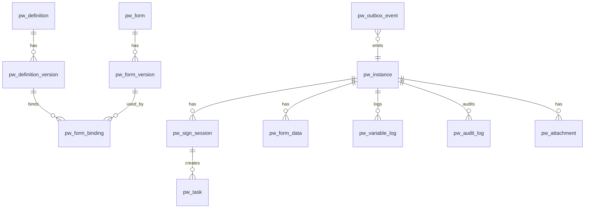

### 10.4 索引、分区与归档

- `pw_task(assignee,status)`、`pw_task(instance_id)`、`pw_task(status,due_at)`；
- `pw_instance(tenant,definition_key,business_key)` 唯一；
- `pw_form_data.indexed_json` GIN；高频字段可另建表达式索引；
- `pw_audit_log` / `pw_variable_log` / `pw_form_data` 按月分区；
- 完成实例超过保留期（如 180 天）归档到 `pw_archive_*`/冷存储；Flowable 历史表按
  `ACT_HI_*` 的结束时间清理/归档（保留审计要求与合规周期）；
- 百万在跑实例：`pw_instance` 按状态/时间分区，热点查询走索引；Flowable 运行表随实例数增长，
  需要容量评估与定期归档。

### 10.5 租户

- 所有业务表带 `tenant_id`；唯一索引包含 `tenant_id`；
- Flowable deployment 设置 `tenantId`；
- 数据权限：`tenant_id + 部门/角色范围` 在 Repository/Service 层强制；
- P2 之前默认 `default`，但表和代码预留，避免后期大改。

---

## 11. 技术组件评估：PG / Redis / MinIO

### 11.1 PostgreSQL

**承担**：

- Flowable 的 ACT_* 运行/历史表；
- 业务表（定义、版本、实例、任务、表单、审计、Outbox、幂等）；
- 事务、行锁、`SKIP LOCKED`、JSONB、GIN、分区、CTE/窗口函数；
- 审计与报表的只读查询。

**配置建议**：

- 独立 schema：`flowable` + `pw`；
- 连接池：HikariCP，按实例数×并发调；Flowable 与业务共用一个 DataSource；
- `flowable.database-schema-update=false`（生产），用官方 SQL 脚本/Flyway；
- history level：MVP `full`；规模上来后评估 `audit` + 自建变量日志；
- 主从/Patroni/RDS 高可用；PITR 备份；
- 大表分区/归档；慢查询监控（pg_stat_statements）。

**边界**：不要用 PG 存附件；不要把大 JSON 表单数据反复更新（表单数据 append-only）。

### 11.2 Redis

**适合**：

- 定义快照/表单 Schema/组织树/字典的缓存（key 带版本号，发布时失效）；
- 限流（按用户/租户/接口）；
- 通知去重、短期幂等快路径、WebSocket 在线状态；
- 可选的延迟队列（ZSET）用于提醒；但**定时器以 Flowable timer/PG 为准**；
- 分布式锁仅用于“非正确性关键”的优化；流程状态/任务并发必须用 PG 行锁/条件更新。

**不适合**：

- 存流程实例/任务/变量当前状态（会丢数据、无法事务一致）；
- 作为 Outbox 的唯一存储；
- 作为唯一幂等记录（PG 表才是权威）。

**部署**：Sentinel 或 Cluster；开启 AOF；缓存 key 设计 `pw:{tenant}:{type}:{version}:{id}`；
缓存穿透/雪崩保护（空值缓存、随机 TTL、singleflight）。

### 11.3 MinIO

**承担**：

- 表单附件（文件/图片/签名）、导出文件、归档包、脚本/模型备份；
- 对象 key：`{tenant}/{instance_id}/{attachment_id}/{filename}`；
- 元数据存 `pw_attachment`（bucket/key/size/sha256/content-type）；
- 生命周期：临时上传 7 天清理；业务附件随实例归档；版本化/对象锁按合规要求；
- 访问：后端签发短时预签名 URL；**不要让浏览器直连内网 MinIO 地址**（预签名 host 必须是外部可达域名）；
- 安全：私有桶、最小权限、病毒扫描（可选）、下载审计。

**边界**：不要用 MinIO 存流程状态；不要把数据库备份只放 MinIO 单副本。

### 11.4 还缺什么

| 组件 | 首版 | 说明 |
|---|---|---|
| nginx / LB | 必须 | TLS、SSO 前置、静态资源、API 反代、限流 |
| SSO / OIDC | 生产必须 | 公司 IdP；本地开发可用 Keycloak |
| Python script-runner | 必须 | 独立部署、禁网、资源限制 |
| 可观测性 | 生产必须 | Prometheus/Grafana、OpenTelemetry、Loki/Tempo |
| MQ | 可选 | 高吞吐事件扇出/服务节点异步化；首版用 Outbox |
| ES/OpenSearch | 可选 | 复杂全文/多维检索；首版 PG GIN |
| 独立 Worker | 中大规模 | Flowable async executor 独立部署 |
| 配置中心/密钥 | 可选 | K8s ConfigMap/Secret、Vault |
| 备份/容灾 | 生产必须 | PG PITR、Redis AOF、MinIO 版本化 + 异地 |

---

## 12. 非功能设计

### 12.1 性能

PRD 目标：创建 1000/s、创建 P99 < 300ms、任务完成 P99 < 500ms、待办查询 P99 < 200ms。
现实评估：

- Flowable 每个实例启动会写 process instance/execution/task/history 多行，1000/s 对单 PG 是
  很高要求；需要多 app 节点 + 高 IOPS PG + 合理 history level + 批量/异步优化。
- **首版目标建议**：创建 100–300/s、P99 < 500ms；压测后再决定是否引入 MQ/异步历史/分区。
- 待办查询走 `pw_task(assignee,status)` 索引，P99 200ms 可达。
- 任务完成到下一节点激活：同步完成 Flowable 推进；脚本调用异步/超时受控；P99 500ms 需实测。
- 单实例并发令牌/执行数限制：Flowable 没有直接“令牌上限”，用活动数/步骤数保护 + 告警。
- 百万在跑实例：PG 分区/归档、Flowable 历史清理、读写分离（报表）。

### 12.2 高可用与扩展

- API/Worker 无状态，水平扩展；
- Flowable async executor 集群：DB 锁保证同一 job 只被一个节点执行；
- Outbox relay 用 `SKIP LOCKED`，多副本安全；
- PG 主从 + 自动故障转移；Redis Sentinel/Cluster；MinIO 多节点纠删码；
- 定时器持久化在 Flowable/PG，重启不丢；
- 发布/升级：Flowable 版本升级需预演，业务表用 Flyway 独立迁移。

### 12.3 安全

- SSO/OIDC；服务间 mTLS/Token；
- 任务/实例权限：assignee、发起人、管理员、部门/租户范围；
- 表单字段权限服务端强制；越权字段丢弃 + 审计；
- 表达式白名单；脚本独立沙箱/禁网；
- 敏感变量加密 + 脱敏 + 访问审计；
- 附件私有桶 + 预签名 + 下载审计；
- 管理干预二次确认/四眼；审计 append-only；
- 防重放：Idempotency-Key、Webhook 时间戳+签名；
- 依赖漏洞扫描/镜像扫描。

#### 12.3.1 角色与权限矩阵（对应 PRD §18）

| 能力 | 设计者 | 流程管理员 | 业务开发者 | 审批人 | 申请人 | 运维 |
|---|---|---|---|---|---|---|
| 创建/编辑流程草稿 | ✓ | ✓ | — | — | — | — |
| 设计/编辑表单 | ✓ | ✓ | — | — | — | — |
| 配置字段权限矩阵 | 提交 | ✓ | — | — | — | — |
| 查看表单数据 | 范围 | ✓（范围） | — | 相关任务 | 仅自己 | ✓ |
| 导出表单数据 | — | ✓（范围） | — | — | — | ✓ |
| 提交发布 | ✓ | ✓ | — | — | — | — |
| 审批发布/下线 | — | ✓ | — | — | — | — |
| 创建实例 | 测试 | ✓ | ✓（API） | — | ✓（发起） | ✓ |
| 审批任务 | — | ✓ | — | 仅本人任务 | — | 代操作 |
| 查看全部实例 | — | ✓（范围） | — | — | 仅自己 | ✓ |
| 人工干预 | — | 部分 | — | — | — | ✓ |
| 改派/改变量 | — | ✓ | — | — | — | ✓（四眼） |

实现方式：Spring Security 的 `@PreAuthorize` + 数据范围过滤（tenant/dept/owner），
不在前端做最终判断；所有越权操作返回 403 并写审计。

### 12.4 可观测

- Metrics：实例创建/完成速率、状态分布、任务积压、节点耗时、脚本错误率、Outbox 积压、
  定时器延迟、Flowable job 失败数；
- Trace：API → 业务 Service → Flowable → 脚本 runner，traceId 贯穿；
- 日志：结构化 JSON，带 tenant/instance/task/trace；
- 告警：实例卡点、join 长时间等待、脚本错误率、Outbox 死信、PG 连接池耗尽；
- 审计：`pw_audit_log` 是排障主入口，时间线合并任务/变量/节点事件。

### 12.5 多租户

- Flowable `tenantId`；业务表 `tenant_id`；
- 唯一约束包含 tenant；
- 数据权限在 Repository 层强制，不依赖前端；
- 配额：并发实例数/日创建量/附件容量；
- 管理端跨租户运维需单独授权 + 审计。

---

## 13. 技术难点清单

### 13.1 Flowable 任务模型 vs 中国式签核

- **难点**：多实例固定、运行中加签、竞签回收、退回重提、转交/委托。
- **方案**：自建 `pw_task/pw_sign_session`，Flowable userTask 只做等待协调器（§3.3）。
- **代价**：自建任务状态机与查询；换来 PRD 语义完整、BPMN 可读。

### 13.2 并行与汇聚

- **难点**：fork/join、嵌套、循环、join 死等。
- **方案**：Flowable execution 树 + parallel gateway；join 严格等待所有入边；
  卡点巡检（活动停留超阈值）告警，不自动跳过；嵌套深度发布期限制 ≤3。
- **测试**：S1 并行分支、嵌套并行、条件跳过导致 join 卡住的告警。

### 13.3 事务与事件一致性

- **难点**：任务完成、表单写入、Flowable 推进、事件投递跨多个组件。
- **方案**：业务表 + Flowable 同 DataSource/同 `@Transactional`；事件写 Outbox；
  提交后 relay；外部 HTTP 不在事务内。
- **坑**：Flowable 自己的事务与 Spring 事务集成；不要用 `REQUIRES_NEW` 把协调任务完成拆出去。

### 13.4 幂等与并发

- **难点**：双击、重复请求、竞签两人同时提交、重复启动。
- **方案**：
  - `(tenant, definition_key, business_key)` 唯一 + 返回已有实例；
  - `Idempotency-Key` 表回放首次响应；
  - `pw_task` 条件更新 `WHERE status IN (...)`，0 行 → 409；
  - `pw_sign_session` 行锁；
  - Flowable 乐观锁异常 → 409/重试。
- **测试**：并发提交同一任务、重复启动、race 双提交。

### 13.5 版本化与长跑迁移

- **难点**：实例钉版本、表单版本绑定、灰度、迁移冲突。
- **方案**：Flowable deployment 版本 + `pw_definition_version`；实例 processDefinitionId；
  `pw_form_binding` 物化；P2 `ProcessMigrationService` + 活动映射 + 预演/回滚。
- **坑**：不要修改已发布 BPMN；不要用“更新部署”覆盖旧版本。

### 13.6 表单权限矩阵

- **难点**：同一表单多节点、字段级权限、越权提交、required 语义。
- **方案**：`pw_form_binding.field_permissions_json`；服务端裁剪 + 丢弃 + 审计；
  前端只渲染服务端给的 access；提交与 Flowable 推进同事务。
- **测试**：S4 五个节点权限；隐藏字段不下发；越权写不改值。

### 13.7 脚本沙箱

- **难点**：不可信代码、资源耗尽、逃逸、可重放。
- **方案**：Python 独立进程/服务 + rlimit + 模块/内置函数白名单 + 固定 now + 输出上限 + 禁网；
  失败重试/onError/FAILED。
- **坑**：`exec` + 清空 builtins 不是沙箱；必须进程/容器隔离。

### 13.8 表达式安全

- **难点**：JUEL 可以调用 Bean/方法，用户可写表达式 = 潜在 RCE。
- **方案**：发布期 AST 白名单；运行期自定义 ExpressionManager；复杂逻辑移到脚本节点；
  金额用 decimal。
- **测试**：拒绝方法调用/Bean 引用/静态方法。

### 13.9 审批人解析与组织

- **难点**：多级主管、部门负责人、角色、空集、离职、委托。
- **方案**：`OrgProvider` 接口 + 本地/Redis 缓存；解析器 user/role/managerOf/deptLeader/
  initiator/expr/script；空集策略（默认管理员）；离职过滤/转上级；委托表 P1。
- **坑**：解析结果要快照到任务上，后续组织变化不影响已创建任务。

### 13.10 超时与工作日历

- **难点**：时区/夏令时/节假日、挂起暂停、提醒升级、自动动作。
- **方案**：Flowable timer + async executor；`pw_calendar`；超时策略表；幂等触发；
  挂起时记录暂停区间。
- **测试**：跨时区、节假日、重复触发只执行一次。

### 13.11 性能与容量

- **难点**：Flowable 每次操作写多表；1000/s 目标；百万实例。
- **方案**：多节点、PG 调优、history level、分区/归档、异步 Worker、缓存只读数据；
  压测驱动，不先上 MQ。
- **坑**：Redis 放流程状态会破坏一致性；过度缓存表单 Schema 导致发布不生效。

### 13.12 多租户

- **难点**：数据隔离、唯一约束、配额、跨租户运维。
- **方案**：Flowable tenantId + 业务 tenant_id；Repository 强制过滤；配额表；审计。
- **坑**：唯一索引漏 tenant 会导致租户间冲突。

### 13.13 前端设计器与表单渲染

- **难点**：BPMN 画布、扩展属性、校验回显、权限驱动表单、移动端。
- **方案**：bpmn-js + React 属性面板；自定义 extensionElements；服务端权限；同一 Schema
  响应式渲染；错误定位到字段/节点。
- **坑**：前端自己推导权限；隐藏字段仍下发；设计器与后端模型不一致。

### 13.14 部署与运维

- **难点**：Flowable schema 升级、脚本 runner 隔离、PG/Redis/MinIO 高可用、
  nginx/SSO 集成。
- **方案**：独立 schema、Flyway、容器/网络策略、监控告警、备份演练、灰度发布。
- **坑**：把 script-runner 暴露公网；MinIO 预签名用内网 host；Flowable 自动建表上生产。

---

## 14. 测试与验收

### 14.1 测试分层

| 层 | 内容 |
|---|---|
| 单元 | 签核裁决（ANY/ALL/RACE/比例/否决）、任务状态机、权限矩阵、表达式白名单、金额 decimal |
| 集成 | Spring Boot + Flowable + PG（测试库/Testcontainers）；BPMN 部署/启动/完成/回滚 |
| API | 鉴权、权限、幂等、错误码、分页 |
| E2E | S1 请假、S2 合同、S4 表单权限；前端 Playwright |
| 性能 | 创建/完成/待办查询压测；Outbox/定时器；长跑实例 |
| 安全 | 表达式逃逸、脚本逃逸、越权字段、越权任务、SSRF（服务节点）、附件访问 |

### 14.2 验收口径

- S1：3 天请假 → 主管 → 并行 HR/总监 → join → 补贴/年假 → 完成；
- S2：>50 万三方并签（任一否决整单否决）；≤50 万竞签（第一个定音，其余回收）；
- S3：发布 v2 后老实例仍跑 v1；新实例走 v2；
- S4：同一表单 5 个节点权限不同；隐藏字段不下发；越权写入被丢弃并审计；
- 幂等/并发：重复启动、双击、竞签双提交；
- 失败：脚本超时/异常走 onError/挂起；管理员重试；
- 迁移（P2）：预演报告、白名单迁移、回滚。

---

### 14.3 PRD §17 边界场景 → 设计响应

| # | 场景 | 本方案响应 |
|---|---|---|
| 1 | 并行分支未全部到达 join | Flowable join 阻塞；活动停留超阈值告警；不自动跳过 |
| 2 | 并行分支写同一变量 | execution 乐观锁 + 实例级串行化；按 retry/fail/last_write_wins 处理并审计 |
| 3 | 审批人解析为空 | `emptyPolicy`：默认指派管理员；可配 auto_approve / fail |
| 4 | 审批人离职/停用 | 解析时过滤 `active=false`；任务显示异常；可配转上级 |
| 5 | 同一任务并发提交 | `pw_task` 条件更新 + 会话行锁；0 行 → 409 |
| 6 | 脚本超时/异常 | 重试 / onError 边 / FAILED 挂起；trace 入审计 |
| 7 | 死循环 | 实例步数 + 节点激活次数上限；超限 FAILED + 告警 |
| 8 | 排他网关无匹配边 | 发布期强制默认边；运行期兜底 + 告警 |
| 9 | 终止时仍有在途任务 | 取消 `pw_task` + `CANCELLED` + 审计 |
| 10 | 发布新版本 | 实例钉 `processDefinitionId`；新实例走默认版本 |
| 11 | 退回后重提 | 显式 `restart`/`resume`；MVP 只支持 restart |
| 12 | 竞签两人同时提交 | 会话行锁 + 条件更新；后到者 409 |
| 13 | 加签后裁决集合变化 | `pw_task` 动态插入；`expected_count++`；沿用原模式 |
| 14 | Webhook 失败 | Outbox 退避重试；超限 DEAD + 告警 |
| 15 | 跨时区/夏令时 | 存储 UTC；展示按用户时区；工作日历按组织时区 |
| 16 | 服务重启时实例在跑 | Flowable/定时器/Outbox 持久化；重启后续跑 |
| 17 | 子流程失败 | callActivity 错误边界/父流程策略：挂起/异常边/终止 |
| 18 | 变量类型不符 | 声明契约校验；严格拒绝/宽松强转 + 审计 |
| 19 | 脚本改了上下文但表单已渲染 | 服务端为准；提交前重新拉取；前端展示最新值 |
| 20 | 提交只读字段新值 | 服务端按权限矩阵丢弃 + 审计，不报错 |
| 21 | 子表单行数超限 | 后端硬限制（默认 200 行）+ 结构化错误 |
| 22 | 表单校验通过但流转前失败 | 停留当前节点；不推进；返回字段级错误 |
| 23 | 竞签后到者数据 | 后到任务回收；其草稿不落 `pw_form_data`，仅审计 |
| 24 | 表单 Schema 升级 | 实例钉 `form_version_id`；旧实例展示旧 Schema |

---

## 15. 实施计划与风险

### 15.1 阶段

| 阶段 | 周期 | 交付 |
|---|---|---|
| M0 技术验证 | 2 周 | Spring Boot + Flowable 7 + PG 跑通 S1；ANY/ALL/RACE PoC；脚本 runner PoC；bpmn-js PoC |
| M1 核心 MVP | 8 周 | 定义/草稿/发布/版本、实例、自建任务层、ANY/ALL、并行网关、**表单设计器 + 基础表单权限**、React 任务中心/表单 |
| M2 完整审批与表单 | 6 周 | RACE、加签/转交/退回/撤回、表单设计器、子表单/联动、超时/通知、服务节点 |
| M3 运维与集成 | 4 周 | 子流程、包容网关、定时/等待、大盘/干预、Webhook、检索/导出 |
| M4 企业化 | 4 周 | 多租户、权限矩阵、压测、迁移工具、安全评审 |

总计约 24 周（与 PRD 23 周接近）；表单和签核任务层是最大工作量。

### 15.2 风险

| 风险 | 等级 | 应对 |
|---|---|---|
| 自建任务层与 Flowable 事务耦合出错 | 高 | 明确事务边界；集成测试覆盖；先做 S1/S2 PoC |
| 加签/退回语义在 Flowable 上实现复杂 | 高 | 自建任务层 + 显式状态机；先冻结语义再写代码 |
| 脚本沙箱逃逸 | 高 | 独立进程/容器、禁网、rlimit、白名单、安全评审 |
| 1000/s 性能不达标 | 中 | 压测驱动；先 100–300/s；必要时异步/分区/MQ |
| 表单范围失控 | 高 | 严守“只服务流程节点”；字段类型冻结；P2 评审 |
| Flowable 升级/schema 变更 | 中 | 固定版本；升级预演；业务 schema 独立 |
| 组织架构实时性 | 中 | OrgProvider + 缓存 + 快照到任务；Q5 决策 |
| 多租户后期改造 | 中 | 表和唯一索引从一开始带 tenant_id |

### 15.3 需要拍板的开放问题

1. **执行内核**：Flowable 7（推荐，本文按此展开）；
2. **任务层**：自建 `pw_task`（推荐）还是直接用 Flowable TaskService（更快但语义受限）；
3. **脚本语言**：保留 Python sidecar（推荐，符合 PRD）还是 Java/GraalVM（偏离 PRD）；
4. **表单渲染器**：自研（推荐首版）还是 formily；
5. **多租户**：P2 还是提前到 M2；
6. **组织架构**：本地镜像 + 定时同步，还是实时调用组织服务；
7. **表达式**：JUEL 白名单（推荐）还是完全自定义求值器。

---

## 16. 附录

### 16.1 BPMN 扩展属性（示例）

```xml
<userTask id="mgr" name="主管审批" flowable:assignee="${signCoordinator}">
  <extensionElements>
    <flowable:field name="formRef"><flowable:string>leave_form</flowable:string></flowable:field>
    <flowable:field name="signMode"><flowable:string>any</flowable:string></flowable:field>
    <flowable:field name="rejectStrategy"><flowable:string>to_start</flowable:string></flowable:field>
    <flowable:field name="assigneeResolver">
      <flowable:string>{"type":"managerOf","level":1,"of":"initiator"}</flowable:string>
    </flowable:field>
    <flowable:field name="fieldPermissions">
      <flowable:string>{"leave_days":{"access":"readonly"},"mgr_comment":{"access":"editable","required":true}}</flowable:string>
    </flowable:field>
  </extensionElements>
</userTask>
```

发布时把这些 extension 解析成 `pw_form_binding` / `pw_sign_session` 配置；BPMN 只保留
“怎么走”，业务配置在发布版本中固化。

### 16.2 错误码

| code | HTTP | 含义 |
|---|---|---|
| `UNAUTHORIZED` | 401 | 未登录/令牌无效 |
| `FORBIDDEN` | 403 | 无权操作 |
| `NOT_FOUND` | 404 | 定义/实例/任务不存在 |
| `VALIDATION_FAILED` | 400 | 定义/表单校验失败（details 带 issues） |
| `VARIABLE_INVALID` | 400 | 变量类型/必填不合法 |
| `TASK_ALREADY_DONE` | 409 | 任务已被处理 |
| `INSTANCE_NOT_RUNNING` | 409 | 实例状态不允许操作 |
| `CONCURRENT_UPDATE` | 409 | 乐观锁冲突，重试/刷新 |
| `SCRIPT_FAILED` | 500/422 | 脚本执行失败（details 带 trace） |
| `OUTBOX_DEAD` | — | 事件死信（运维告警） |

### 16.3 术语表

| 术语 | 含义 |
|---|---|
| 定义/版本 | 流程的稳定 key 与不可变快照 |
| 协调任务 | Flowable 中等待签核结论的系统 userTask |
| 签核会话 | 一次人工节点上的裁决上下文（模式/计数/结论） |
| 任务 | 业务待办（`pw_task`），不是 Flowable TaskService 的 task |
| Outbox | 事务内落库、事务外投递的事件表 |
| 快照 | 发布版本的 BPMN + model_json + 表单绑定 |

### 16.4 参考资料

- PRD v1.1：`index.html`（https://davisu-china.github.io/pipewise/）
- Python MVP 实现契约：`docs/tech-design.md`
- Flowable 7 文档：https://documentation.flowable.com/
- bpmn-js：https://bpmn.io/toolkit/bpmn-js/
